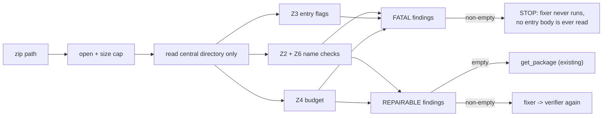

# Security Verifier — design (no implementation yet)

Scope: define the shape of a component whose single job is *"is this zip generally
safe to accept"* — i.e. it is a zip, and reading it cannot explode memory, disk, or
time. It is the **Z-layer** of the validator pipeline in `docs/validator-requiements.md`.

Numbers below are the **spec defaults** (profile v1, §2.1 Z4). They are design inputs,
not tuned values.

---

## 1. Where it sits

`verify_ebook` today is:

```
get_book  ->  get_package  ->  check_cover  ->  check_nav  ->  verify_chapter *
```

The security verifier **replaces `get_book`**; it does not add a parallel stage. Everything
downstream already assumes "we have a usable, bounded zip", so a failure here must stop the
pipeline before any content is parsed.

**Pipeline order is `verifier -> fixer -> verifier`** (not the spec's `fix -> validate`). This
matters: the verifier sees the **raw** input, so it must classify every finding by whether the
fixer could have dealt with it — see §2. The second pass is what makes the loop converge: the
fixer is allowed to rewrite the zip, so it gets re-checked, and anything it *introduced* is
caught by the same fatal rules.



Not a security concern here: **Z5 (mimetype placement/encoding)** — that is a *repair*
(fixer's job), not a safety property. A misplaced mimetype is a well-formed, harmless file.

---

## 2. Responsibility split (AI-rule §2/§3: design before implement, one job per function)

| Unit | Sole responsibility | Requirement |
|---|---|---|
| `open_bounded(path)` | produce a seekable source **without slurping the file**; reject if the file on disk already exceeds the total budget | Z1, Z4 (cheap pre-filter) |
| `read_index(source)` | parse the **central directory only** — no entry body is ever inflated | Z1 |
| `check_name(name)` | one entry name: absolute? backslash? NUL? `..` escape? control char? invalid UTF-8? | Z2, Z6 |
| `check_entry_flags(entry)` | symlink / encrypted / unsupported method | Z3 |
| `check_budget(entries)` | per-entry size, entry count, ratio, running total | Z4 |
| `classify(name, entry)` | map one finding to `FATAL` or `REPAIRABLE` — the *only* place the policy lives | — |
| `verify_zip_safety(path)` | sequence the above; **stop on any FATAL**, else return the soft list | — |

Design rules that fall out of this table:

- **`check_name` is pure** (`&str -> bool + reason`). It is shared by Z2 and Z6 because they
  are the same predicate over the same input; splitting them into two functions would
  re-implement path parsing twice (AI-rule §3: keep related behaviour together).
- **`check_budget` is a fold over the index**, not a loop with side effects in the caller.
  The budget is a value type (`Budget { total, max_entry, max_count, max_ratio }`) so the
  limits are one place to change and tests can construct a tight budget without touching
  the code (see §5).
- **No function in this layer reads entry bytes.** Anything that decompresses belongs to a
  later layer (cover / chapter readers). This is what makes the layer cheap and total.

## 2b. Two-tier reporting (decided: aggregate, but never at the cost of security)

The rule the user set: **things that cannot be repaired automatically, or that would cause a
security issue, break the pipeline. Everything else is aggregated.** So the return value is not
`Result<(), ZipError>` — it is a partition:

```
ZipSafety =
  | Fatal(Vec<ZipError>)          // security-relevant, non-empty -> HARD STOP
  | NeedsFix(Vec<RepairNote>)     // safe, but not spec-clean -> hand to fixer
  | Clean
```

**A non-empty `Fatal` short-circuits everything.** No `fixer`, no `get_package`, no entry body
is ever opened. Aggregation applies *within* a tier, never across tiers: collecting five bad
names is useful, but collecting them alongside a zip bomb and then continuing is not.

| Tier | Findings | Why it is in that tier |
|---|---|---|
| **FATAL** | not a zip / truncated / unreadable (Z1) | the fixer cannot synthesise an archive from nothing |
| **FATAL** | file on disk > `TOTAL_UNCOMPRESSED` (Z4 pre-stat) | opening it at all is the attack |
| **FATAL** | entry count, per-entry size, ratio, running total (Z4) | the fixer cannot shrink a bomb; and reading bodies to find out *is* the attack |
| **FATAL** | name escapes the root (`..`), absolute name, NUL byte (Z2) | `zip-slip`: any extraction that honoured it already wrote outside the tree |
| **FATAL** | symlink entry, encrypted entry (Z3) | symlink = redirection to an arbitrary target; encrypted = **rejected outright for now** (policy decision, see §6) |
| **REPAIRABLE** | `\` separator in a name (Z2) | pure rename, content untouched |
| **REPAIRABLE** | control characters in a name (Z6) | pure rename |
| **REPAIRABLE** | name not valid UTF-8 (Z6) | pure rename (to a transliterated/percent form) |
| **REPAIRABLE** | mimetype not first / compressed / wrong content (Z5) | repack — fixer's job, out of the verifier's scope |

Two invariants follow, and both are checkable:

1. **`Fatal` implies zero bytes of entry content were read.** Enforced by construction: the
   fatal checks all run off the central directory. A test asserts the verifier never calls
   `data_start()`/inflate on a fatal fixture.
2. **The fixer must never make a `Clean` zip non-`Clean` on the second pass.** It renames and
   reorders; it does not add entries or inflate bodies. The second verifier pass is the backstop
   that turns "I believe the fixer is shrinking-safe" into a checked claim — if it ever regresses
   on a budget or escape rule, the loop reports `Fatal` and the book is refused, not looped.
   Terminate the loop at one repair round; a second round that changes nothing is a bug.

Error surface stays inside the existing hierarchy (`ZipError` gains two variants):

```
ValidationError.Zip(ZipError.ZipFileMissing)   // path does not exist
ValidationError.Zip(ZipError.Internal(e))      // not a zip / truncated / unreadable
ValidationError.Zip(ZipError.UnsafeEntry(reason, name))   // NEW — Z2/Z3, reason = requirement ID
ValidationError.Zip(ZipError.Budget(kind, actual, limit)) // NEW — Z4, kind = count|entry|ratio|total
```

Reason codes are the requirement IDs (`Z2`, `Z3`, `Z4`, `Z6`) per §216, so a caller can tell
"zip-slip" from "zip bomb" without parsing message text. `RepairNote` is a separate, smaller type
(`{ requirement: Z2|Z5|Z6, entry: Option<String>, action }`) — repair findings are **not**
`ZipError`s, because they are not rejections. Keeping the two types apart is what prevents a
repairable finding from ever being mistaken for a security failure.

---

## 3. The core algorithm (central-directory-only)

The whole point is: **the central directory is metadata, and metadata lies.** Trust it for
budgeting, but never let it drive an allocation.

1. `stat` the file. If `size > TOTAL_LIMIT` → **FATAL** `Z4/total` immediately. This is the
   cheap pre-filter and it fixes the current hazard: `get_book` does
   `fs::read(zip_path)` → `Cursor::new(bytes)`, which materialises the *entire* file in RAM
   before anything is checked. The verifier must open the file as a seekable handle
   (`ZipArchive::new(File)`), not a byte cursor.
2. Parse the EOCD + central directory. Failure → **FATAL** `Z1/Internal`.
3. `count = len()`. If `count > ENTRY_COUNT_LIMIT` → **FATAL** `Z4/count`, **before** touching
   any names (a 10k-entry zip costs nothing to reject).
4. Single pass over the index (no decompression, no seek to body), pushing findings into two
   buckets:
   - `name_raw()` → UTF-8 decode → `check_name`. Escaping-root / absolute / NUL → **FATAL**
     `Z2`. Backslash separator → **REPAIRABLE** `Z2`. Control char or undecodable →
     **REPAIRABLE** `Z6`.
   - `encrypted()` or `is_symlink()` → **FATAL** `Z3`.
   - `size()` vs `PER_ENTRY_LIMIT` → **FATAL** `Z4/entry`.
   - `compressed_size()` vs `size()` → ratio vs `RATIO_LIMIT` → **FATAL** `Z4/ratio`.
     Guard the divide: `compressed_size == 0` is only legal when `size == 0`; otherwise the
     ratio is infinite → **FATAL**.
   - accumulate `total += size()`; if running total > `TOTAL_LIMIT` → **FATAL** `Z4/total`.
5. If `fatal` is non-empty → return `Fatal(fatal)`. **Stop: the fixer is not invoked and no
   entry body is opened.**
6. Else if `repairable` is non-empty → return `NeedsFix(repairable)`.
7. Else `Clean`; hand the same handle to `get_package`.

Complexity: O(entries), constant memory, no I/O past the trailing directory record. A 540 MB
bomb costs the same as a 5 KB book. Note the pass is *not* short-circuited on soft findings —
that is the point of aggregation — but a FATAL found at entry 3 still aborts the loop, because
continuing would spend the budget check on a zip we already know is unsafe.

### The declared-size trap

`size()` and `compressed_size()` come from the **central directory**, which is attacker
controlled. A local header can lie (or be absent — `data_start()` returns `Option`). Two
consequences for the design:

- The budget is an **upper bound on declared sizes**, and it is enforced again at read time:
  any later reader (`check_cover`, `verify_chapter`) must stream with a byte counter and
  abort on overflow, not `read_all`. This is a stated invariant of the layer below, not
  something the security verifier can guarantee alone.
- Ratio computed from declared values can be *understated*. Accept this for v1 and note it:
  the hard backstop is the per-entry byte counter in readers plus `TOTAL_LIMIT`. Do not try
  to verify ratio by inflating — that is exactly the attack.

### Limits (spec defaults, §2.1 Z4)

| Limit | Default | Rationale for the constant |
|---|---|---|
| `TOTAL_UNCOMPRESSED` | 500 MB | a real EPUB is 1–50 MB; 10× headroom |
| `PER_ENTRY_UNCOMPRESSED` | 100 MB | a single XHTML/cover image never approaches this |
| `ENTRY_COUNT` | 10 000 | novels have O(10²) chapters + assets |
| `COMPRESSION_RATIO` | 100:1 | deflate on prose tops out near 20:1 |
| `MAX_FILE_ON_DISK` | = `TOTAL_UNCOMPRESSED` | cheap pre-stat |

All five live in one `Budget` struct constructed by the profile, so a test can build
`Budget { total: 1 MB, ratio: 2 }` and prove the checks fire without shipping a 500 MB fixture.

---

## 4. What is deliberately out of scope

| Not checked here | Why |
|---|---|
| mimetype first/stored/exact content (Z5) | repair, not safety — reported as `NeedsFix`, never `Fatal` |
| name normalisation / separator rewriting (Z2 FIX half) | fixer rewrites names; the verifier only rejects the *escaping* subset |
| OPF, manifest, spine, nav, chapters | content layer, later stages |
| decompression *validity* of bodies | requires inflating, which is what we are avoiding |

**Encryption is no longer out of scope**: encrypted entries are **hard-rejected** (`Fatal Z3`)
in this profile. A DRM'd EPUB is therefore refused outright rather being flagged for a policy
call — accepted for now, and it is the one decision most likely to flip later (see §6). If
DRM support is added, it becomes a caller-supplied `allow_encrypted: bool` on the profile that
moves encrypted from the FATAL row to the `NeedsFix` row — it must not become "ignored", or the
loop would silently accept a container it cannot read.

---

## 5. Test plan (AI-rule §4/§5: group by behaviour, test observable behaviour, never weaken)

Harness is unchanged: `check(book)` opens `./target/broken_epubs/{book}.epub` and asserts
against the expected error shape. Group tests by **observable rejection reason**, not by
fixture name.

| Existing fixture | Expected observable |
|---|---|
| `z1_not_a_zip`, `z1_truncated_zip` | `Zip(Internal(_))` — already covered by `unreadable_zip` |
| `z2_backslash_name`, `z2_absolute_name`, `z2_escapes_root`, `z2_nul_byte_name` | `Zip(UnsafeEntry("Z2", name))` |
| `z6_control_char_name` | `Zip(UnsafeEntry("Z6", name))` |
| `z3_symlink`, `z3_encrypted_entry` | `Zip(UnsafeEntry("Z3", name))` |
| `z4_compression_ratio` | `Zip(Budget("ratio", …))` |
| `z4_too_many_entries` (10 001) | `Zip(Budget("count", 10001, 10000))` |
| `z4_entry_too_large` (HUGE) | `Zip(Budget("entry", …))` |
| `z4_total_too_large` (HUGE) | `Zip(Budget("total", …))` |

Note the ordering this table pins down: `z4_too_many_entries` must be caught by the **count**
check (step 3), not by name checks — it has 10 001 legal names. If the count check runs
after the per-entry loop, that test still passes but the layer is no longer O(1) on
reject; keep count first.

**None of these fixtures are asserted by the current 12 tests** — the Z-layer fixtures exist on
disk but are untested. Adding them is new work, and it carries one concrete regression risk:
`v1_cover_path_escape` and `x3_chapter_escape` currently expect
`Cover(PathEscape)` / `Chapter(PathEscape)`, which come from an escaping *href* deep in the
pipeline. If either fixture also stores an escaping *entry name*, the new Z2 FATAL check fires
first and the observable outcome moves to `Zip(UnsafeEntry("Z2", …))`. That is a strengthening,
not a weakening (AI-rule §5), but it must be a **deliberate** change to those expectations —
check the fixtures before touching the tests, and if both layers fire, assert the Z-layer one
and delete the now-unreachable content-layer expectation rather than loosening the matcher to
`Err(_)`.

Behaviour tests to add alongside (not fixture-driven, since shipping a 500 MB fixture is
wasteful):

- `Budget` unit tests on a synthetic in-memory index: tight limits, `compressed_size == 0`
  with `size > 0`, `size == 0` with `compressed_size == 0` (legal, ratio undefined but safe).
- A **positive** test: the canonical valid book passes with zero allocations proportional to
  file size — assert the verifier never calls `data_start()`/inflate. This is the
  "verify integration, not just compile" check (§5) for the no-decompression invariant.
- A test that the pre-stat rejects a file larger than `TOTAL_UNCOMPRESSED` **without**
  parsing the zip at all — this is the regression guard on the `fs::read` slurp.
- **Tier tests, fixture-driven:** a fixture with *only* soft findings (`z2_backslash_name`,
  `z6_control_char_name`) must return `NeedsFix`, not `Fatal` — i.e. it must still reach
  `get_package` in a verifier-only call and not be refused. A fixture with one escaping name
  **plus** one control-char name must return `Fatal` and must **not** report the control-char
  finding as if it were recoverable.
- **Aggregation test:** one fixture with three distinct soft findings (backslash + control char
  + bad mimetype) asserts all three `RepairNote`s are present at once. This is the test that
  pins the decision to aggregate; without it, a first-failure implementation passes every other
  test in the file.
- **Fixer round-trip:** fixed output of any soft fixture re-runs through the verifier and must
  yield `Clean`. This is the loop-convergence check, and it is the only test that catches a fixer
  that renames into something still unsafe.

Do not remove or relax the existing 12 tests: the new variants are additive, and every
previously-passing fixture must still land in the same `ZipError` bucket.

---

## 6. Settled (was: open questions)

1. **Aggregate, with a hard-stop tier.** See §2b: `Fatal` short-circuits, `NeedsFix` is
   aggregated. Aggregation never crosses tiers — soft findings are never reported as if
   recoverable alongside a fatal one, because the run does not continue in that case.
2. **Encrypted entries: hard reject.** `Fatal Z3` in this profile; DRM books are refused. A
   `allow_encrypted` policy flag is the anticipated future change, not built now.
3. **Fixer runs *after* the verifier: `verifier -> fixer -> verifier`.** The verifier therefore
   sees raw input, which is exactly why the FATAL/REPAIRABLE split exists — anything the fixer
   could have repaired must not be a rejection, and anything it cannot must be. This **contradicts
   the order written in `docs/validator-requiements.md` §2.1 (`fix -> validate`)**; the spec text
   should be updated to match, otherwise the two documents disagree and the Z5/Z2-FIX rows in §4
   are argued from the wrong premise.

Still open, and genuinely load-bearing:

4. **`NeedsFix` is not a pass — it is a routing signal.** Decided: `NeedsFix` means "send this
   book to the fixer", not "this is okay". Concretely: the Z-layer verifier returns the `ZipSafety`
   tri-state (`Fatal` / `NeedsFix` / `Clean`) rather than a `Result`; only the post-fixer round is
   a `Result`, and the `verifier -> fixer -> verifier` loop lives in the caller. Nothing maps
   `NeedsFix` to `Ok` or `Err`. This changes `verify_ebook`'s signature, which the test harness
   calls directly — so the harness grows a `check_safety()` helper next to `check()` that maps
   `ZipSafety` back to the pass/fail predicate each behavior test expects.

Still open:

5. **Stream or `Cursor<Vec<u8>>` downstream?** Same question as before — `get_book`'s unbounded
   slurp vs threading a seekable handle. Six production signatures hard-code
   `ZipArchive<Cursor<Vec<u8>>>` today (`get_book` return, `get_package`, `read_zip_text`, and the
   three cover/nav/chapter readers), so a change is mechanical type-parameter churn, not semantic
   churn. Benefits/downsides of each option are tracked in discussion; decide at implementation
   time.
